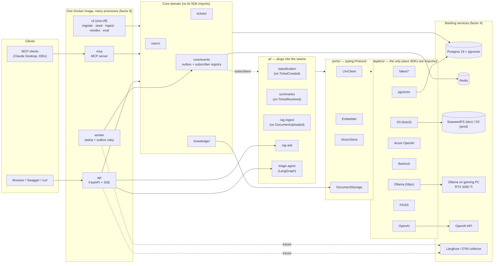
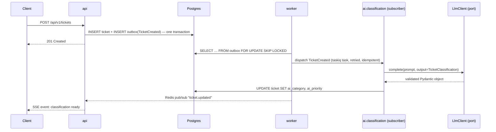

# Roadmap — Helpdesk + Knowledge Base, an AI-ready modular monolith

_Written 2026-11-23 · Companion to [`AUDIT.md`](AUDIT.md) · ADRs live in [`adr/`](adr/0000-template.md)_

## How to read this

**Your constraints (from your answers):**

| Constraint | Consequence for the plan |
|---|---|
| **15–20 h/week** | The original brief is sized for ~30 h/week. Each week below is trimmed to ~16–19 h of core tasks; everything else is marked *Stretch*. Plan for **14 calendar weeks**: 12 working weeks plus 2 buffer weeks (after Week 3 and after Week 9). Buffers are not optional: Phase 1 and the RAG eval week are where everyone overruns. |
| **Only an OpenAI API key** | OpenAI is the live commercial provider. Azure OpenAI and Bedrock adapters are built and **contract-tested against the documented APIs** (stubbed HTTP and botocore `Stubber`), not run live. Anthropic moves to Stretch. Be precise about this in interviews (see Week 6). |
| **Gaming PC: RTX 3060 Ti (8 GB VRAM), 16 GB RAM** | Ollama runs there and serves the LAN. 8 GB fits one 7–8B instruct model at Q4 plus an embedding model. Your laptop (30 GB RAM, no GPU) runs everything else. |
| **Evolve `fastapi_blog` in place** | Week 1 starts by repairing git, then renaming the package to `helpdesk` and restructuring. Every task names the existing file it moves or replaces. `templates/` and `static/` are dropped. |

**Scope cuts against the brief, decided up front:**

| Brief asks for | Plan | Why |
|---|---|---|
| OpenAI, Anthropic, Azure, Bedrock, Ollama adapters | OpenAI + Ollama **live**; Azure + Bedrock **contract-tested**; Anthropic *Stretch* | Adapters you can't run teach the port design once; doing it twice more adds little. |
| FAISS, Chroma, Pinecone, pgvector | pgvector (**primary**) + FAISS (**eval baseline**); Chroma and Pinecone as an ADR comparison and *Stretch* | Four adapters behind one port is repetition. The trade-off write-up is what interviewers ask about. |
| SSE **or** WebSocket | SSE only, using FastAPI's built-in `fastapi.sse` | It's one-directional server push, which is what you need, and it needs no extra dependency. |
| Rate limiting in Week 3 | Moved to Week 6, where it protects paid AI endpoints | Same work, done when it matters. |
| Knowledge graph | *Stretch* in Week 9 | Can't fit at 15–20 h. |
| Service extraction | *Stretch* in Week 12 | As in the brief. |
| MinIO locally | **SeaweedFS** (S3 API) locally, S3 in prod | MinIO images are no longer published on Docker Hub (`minio/minio` returns "object not found", checked 2026-11-23). It makes a good demonstration of why `DocumentStorage` is a port. |

**Task notation:** `- [ ] … (~2h)` means a time estimate for one sitting. Paths are relative to the repo root (`fastapi_blog/`).

---

## Architecture

### End state (after Week 12)



### The socket, in one flow



Core code only ever writes the outbox row. Phase 2–4 features are **new subscribers and new adapters**; none of them edits `tickets/`.

### How it grows, phase by phase

| Phase | Processes | Backing services | Seams | AI behind the ports |
|---|---|---|---|---|
| 1 (W1–3) | `api`, `worker`, `cli` | Postgres+pgvector, Redis, SeaweedFS | Events + outbox, 4 ports with fakes | Fakes only |
| 2 (W4–6) | same | + OpenAI, + Ollama on gaming PC | `LlmClient` gets structured output, streaming and tool calls | Classification, summaries, budgets, fallback |
| 3 (W7–9) | same | pgvector used for real, FAISS in-process | `Embedder`, `VectorStore`, `Reranker` used for real | Ingestion, hybrid search, cited answers |
| 4 (W10–12) | + `mcp` | + Langfuse/OTel | `ToolProvider` port (MCP client) | Triage agent, MCP, guardrails, evals in CI |

---

## Final directory structure

```
fastapi_blog/                     # repo root (rename the folder to helpdesk/ whenever convenient)
├── pyproject.toml  uv.lock  .python-version
├── .env.example                  # every setting, no values — the config contract
├── compose.yaml                  # postgres, redis, s3, api, worker, (mcp)
├── Dockerfile  .dockerignore     # one multi-stage image for every process
├── .pre-commit-config.yaml
├── .github/workflows/ci.yml      # lint → types → tests → build → (evals)
├── alembic.ini  alembic/         # migrations (admin process, factor 12)
├── docs/  AUDIT.md  ROADMAP.md  adr/
├── evals/
│   ├── datasets/                 # *.jsonl golden sets you write by hand
│   └── reports/                  # generated markdown reports, committed
├── src/helpdesk/
│   ├── main.py                   # create_app() + lifespan
│   ├── config.py                 # Settings — the ONLY place env vars are read
│   ├── wiring.py                 # composition root: Settings → adapters (lazy imports)
│   ├── worker.py                 # taskiq broker, outbox relay, subscriber tasks
│   ├── cli.py                    # Typer: seed, ingest, reindex, eval …
│   ├── mcp_server.py             # Phase 4
│   ├── core/
│   │   ├── db.py                 # async engine, session factory, Base, SessionDep
│   │   ├── security.py           # password hashing, JWT
│   │   ├── errors.py             # DomainError hierarchy + exception handlers
│   │   ├── events.py             # DomainEvent, outbox writer, subscribe() registry
│   │   ├── logging.py            # structlog JSON config, request-id middleware
│   │   ├── pagination.py         # Page[T], cursor helpers
│   │   └── health.py             # /health/live, /health/ready
│   ├── users/      router.py service.py models.py schemas.py dependencies.py
│   ├── tickets/    router.py service.py models.py schemas.py events.py workflow.py
│   ├── knowledge/  router.py service.py models.py schemas.py events.py search.py
│   ├── ports/      llm.py embedder.py vector_store.py storage.py reranker.py tools.py
│   ├── adapters/
│   │   ├── fakes/  llm.py embedder.py vector_store.py storage.py
│   │   ├── storage_s3.py
│   │   ├── llm_openai.py  llm_azure.py  llm_ollama.py  llm_bedrock.py
│   │   ├── embedder_openai.py  embedder_ollama.py
│   │   └── vector_pgvector.py  vector_faiss.py
│   └── ai/
│       ├── prompts/              # versioned prompt files: <feature>/v1.md
│       ├── resilience.py         # retry/timeout/budget/metering wrappers around ports
│       ├── classification.py  summaries.py  guardrails.py
│       ├── rag/    parsing.py chunking.py ingest.py retrieve.py answer.py pii.py
│       ├── tools/  ticket_stats.py   # typed SQL-backed functions (Week 9), reused by agent + MCP
│       ├── agents/ triage.py tools.py
│       └── evals/  retrieval.py judge.py runners.py
└── tests/
    ├── conftest.py               # testcontainers Postgres, app + client fixtures
    ├── unit/  integration/  contract/  evals/
```

**Why this shape:**
- **Feature folders** (`users/`, `tickets/`, `knowledge/`). A change to tickets touches one folder. Each folder is a candidate module to extract later, and import rules can be checked per folder.
- **No `repositories/` layer.** `AsyncSession` already is a unit of work plus identity map. Service *functions* take a session and run queries directly. Extract a query helper only when a query is reused or complex. This replaces the Spring Data reflex from the audit (ADR-0003).
- **`ports/` separate from `adapters/`.** Core and `ai/` depend only on `ports/`. A ruff `banned-api` rule fails CI if `openai`, `boto3`, `langchain*` or similar are imported outside `adapters/` (or `ai/agents/` for LangGraph, see ADR-0020).
- **`wiring.py` is the composition root.** It's the one place that knows which concrete adapter matches `settings.llm_provider`. Adapters are imported lazily, so `LLM_PROVIDER=fake` doesn't need the OpenAI SDK at runtime.
- **`config.py` at the top level.** Settings are cross-cutting and read once. Nothing else touches `os.environ`.
- **`ai/` is a plug-in layer.** It subscribes to events and calls ports. Delete the folder and the helpdesk still works (Phase 1 exit test).

---

# Phase 1 — Base application: the "socket" (Weeks 1–3)

## Week 1 — Foundations: repo, tooling, config, Compose, auth, tickets CRUD

**Goal:** a clean, typed, tested repo where an authenticated user can create and read tickets against Postgres running in Compose.

**Concepts to learn**
- **Build and dependencies.** In Spring you'd use Maven/Gradle scopes. In Python you use `uv add` and `uv add --dev` (dependency groups), and `uv.lock` pins the entire tree (Maven doesn't lock transitive deps by default).
- **Config.** In Spring you'd use `@ConfigurationProperties` + `application.yml`. In FastAPI you use a pydantic-settings `Settings` class, validated at startup and injected via `Depends(get_settings)`.
- **Package by feature.** In Spring you'd (often) use `controller/ service/ repository/` packages. In Python you use `tickets/router.py`, `tickets/service.py`: modules group related code.
- **DI.** In Spring you'd use constructor injection plus `@MockBean` in tests. In FastAPI you use `Annotated[T, Depends(fn)]` aliases (`SessionDep`, `CurrentUser`) plus `app.dependency_overrides` in tests.
- **Concurrency model.** In Spring MVC you'd get a thread per request. In FastAPI, `async def` runs on one event loop, so a blocking call stalls *everyone*. Sync `def` endpoints run in a threadpool. You'll go fully async: SQLAlchemy `AsyncSession` on psycopg 3 (the same driver you already use).
- **Errors.** In Spring you'd use `@ControllerAdvice` + `ResponseStatusException`. In Python, services raise plain `DomainError` subclasses, and handlers registered once map them to RFC 9457 `application/problem+json`.
- **Validation.** In Spring you'd use Bean Validation (`@Email`, `@Size`). In Pydantic v2 you use `EmailStr`, `Field(min_length=…, max_length=…)` and `Annotated` constraints.
- **Functions over classes.** In Spring you'd write a `@Service` class with injected fields. In Python, a module of `async def create_ticket(session, data, actor) -> Ticket` functions is enough. Reach for a class only when it holds real state.

**Tasks**
- [ ] **Repair git.** Run `git rm -r --cached -q .` (this clears the stale `fastapi_blog/…` index entries). Extend `.gitignore` with `.mypy_cache/ .ruff_cache/ .pytest_cache/`, then `git add -A`. Confirm `git status` shows root-level paths only and `.env` is absent. First commit: `chore: baseline from course`. Decide whether to keep the `origin` remote (`…/master.git`) or create a dedicated `helpdesk` GitHub repo (recommended for a portfolio). (~0.5h)
- [ ] **Rename and prune.** Run `git mv src/fastapi_blog src/helpdesk`. Update `pyproject.toml` (`name`, `description`, remove the `[project.scripts]` placeholder). Delete `templates/`, `static/` and the `main()` in `__init__.py`. (~0.5h)
- [ ] **Tooling.** Run `uv add --dev ruff mypy pytest pre-commit "testcontainers[postgres]"`. Add `[tool.ruff]` (enable `E,F,I,UP,B,SIM,ASYNC,FAST,TID,S`), plus `[tool.ruff.lint.flake8-tidy-imports.banned-api]` banning `openai`, `anthropic`, `boto3`, `langchain`, `langgraph` and `faiss`, with per-file ignores for `src/helpdesk/adapters/**` (and later `src/helpdesk/ai/agents/**` for LangGraph only). Add `[tool.mypy] strict = true, plugins = ["pydantic.mypy"]` and a `.pre-commit-config.yaml` (ruff, ruff-format, mypy). Run `uv lock --upgrade` to pick up the patch releases from the audit. (~2h)
- [ ] **Config.** Move `src/helpdesk/core/config.py` → `src/helpdesk/config.py`. Use lowercase fields (`database_url: PostgresDsn`, `db_echo: bool = False`, `jwt_secret: SecretStr`, `jwt_ttl_minutes`, `environment`), build `env_file` from `Path(__file__)`, and add an `@lru_cache get_settings()`. Write `.env.example`. Delete `load_dotenv`/`os.environ` from `db/database.py` and `alembic/env.py`. Run `uv add pydantic-settings` (declare what you import). (~1.5h)
- [ ] **Compose.** `compose.yaml` with `pgvector/pgvector:pg18` on host port **5433** (stop the old tutorial container first), `redis:8-alpine` and `chrislusf/seaweedfs` (`server -s3`), each with a healthcheck. Pin the image tags you test with. (~1.5h)
- [ ] **Async DB + app factory.** Move `db/database.py` → `core/db.py`: `create_async_engine(settings.database_url)` (the `postgresql+psycopg://` URL works for both sync and async), `async_sessionmaker(expire_on_commit=False)`, `SessionDep`. Move `models/base.py` into it. Rewrite `main.py` as `create_app()` whose lifespan calls `engine.dispose()` on shutdown. Fix `alembic/env.py`: read `settings`, `import helpdesk.models`-style registration, remove the duplicate `config =` and the `sys.path` hack. Keep migrations sync (simpler, same URL). (~2h)
- [ ] **Error model.** In `core/errors.py`, define `DomainError` → `NotFound`, `Conflict`, `PermissionDenied`, `InvalidTransition`, plus handlers returning problem+json. Replace the `HTTPException` in the old `services/user_service.py`. Map `IntegrityError` on unique constraints to `Conflict`. (~1.5h)
- [ ] **Users feature.** Build `users/models.py` from `models/user_model.py`: add a `role` enum (`requester|agent|admin`), `is_active`, `created_at`; drop `index=True` on the PK. Merge `schemas/user_create.py` + `schemas/user_response.py` into `users/schemas.py` (`EmailStr`, length limits, password ≥ 12; drop `from_attributes` on the input schema). Turn `services/user_service.py` into functions in `users/service.py`. Build `users/router.py` from `api/user_controller.py` (no `print`; return types instead of `response_model`). Delete `repositories/`, `api/`, `schemas/`, `services/`, `models/`. Write a new Alembic revision. (~2h)
- [ ] **Auth.** `core/security.py`: `pwdlib[argon2]` hashing and PyJWT encode/decode. `POST /api/v1/auth/token` (OAuth2 password form), a `CurrentUser` dependency, and a `require_role(*roles)` dependency factory. (~3h)
- [ ] **Tickets CRUD.** `tickets/models.py` (title, description, `status` enum, `priority` enum, nullable `category`, `requester_id`, `assignee_id`, timestamps), `schemas.py`, `service.py`, `router.py` under `/api/v1/tickets`. Requesters see only their own tickets; agents and admins see all. (~3h)
- [ ] **Test harness.** `tests/conftest.py`: a session-scoped testcontainers Postgres (pgvector image), `alembic upgrade head` once, a per-test transaction rolled back at the end, an `httpx.AsyncClient(transport=ASGITransport(app))` fixture, `@pytest.mark.anyio` (the anyio plugin ships with Starlette, so no pytest-asyncio is needed), and a `dependency_overrides` fixture for an authenticated user. (~2.5h)

**Acceptance criteria**
- `uv run ruff check . && uv run ruff format --check . && uv run mypy src` exit 0. `pre-commit run -a` passes.
- `docker compose up -d` reports all services healthy. `uv run alembic upgrade head` works on an empty DB, and `alembic downgrade base` round-trips.
- `git grep -nE "os\.environ|load_dotenv" -- src alembic` returns nothing.
- Tests pass, with no network access needed:
  - `test_register_stores_argon2_hash_not_plaintext`
  - `test_duplicate_email_returns_409_problem_json`
  - `test_invalid_email_returns_422`
  - `test_login_returns_bearer_token` / `test_wrong_password_returns_401`
  - `test_tickets_require_auth_401`
  - `test_requester_cannot_read_other_users_ticket_returns_404` (404, not 403, so ticket IDs don't leak)
  - `test_agent_lists_all_tickets`
  - `test_missing_ticket_returns_404_problem_json`

**12-factor checkpoint:** 1 (codebase), 2 (dependencies), 3 (config), 4 (Postgres as an attached resource), 10 (Compose parity).

**ADRs to write:** 0001 *Modular monolith with feature packages*, 0002 *Async SQLAlchemy on psycopg 3*, 0003 *No repository layer by default*, 0004 *Problem Details for errors*.

**Stretch:** refresh tokens; `ty` as a second type checker to compare against mypy; a `justfile`/Makefile alias set.

**Interview talking point:** "I treat config as a typed contract: one pydantic-settings class, validated at startup, and a lint rule that fails CI if anything else reads the environment. And I return 404 instead of 403 for tickets you don't own, so IDs can't be enumerated."

**Portfolio artifact:** a green CI badge (from Week 3) and `docs/adr/0001…0004`.

---

## Week 2 — Ticket workflow, teams, comments, documents, search, logging

**Goal:** the helpdesk is genuinely usable. Tickets move through a workflow, have comments and attachments, and are searchable, with structured logs for every request.

**Concepts to learn**
- **State machines.** In Spring you'd reach for Spring State Machine or a State pattern. In Python, a `dict[Status, frozenset[Status]]` of allowed transitions plus one function is enough.
- **Generic response models.** In Java you'd write `Page<T>`. In Pydantic you write `class Page[T](BaseModel)` (PEP 695 generics).
- **Query models.** In Spring you'd use `@ModelAttribute` on a filter DTO. In FastAPI you use `Annotated[TicketFilters, Query()]`.
- **Ports.** In Spring you'd write an `interface` plus `@Component` implementations. In Python you write a `typing.Protocol` that nothing has to inherit from (more in Week 3).
- **Request context.** In Spring you'd use MDC / `ThreadLocal`. In Python you use `contextvars`, bound into structlog. They survive `await`, while thread-locals don't.
- **Middleware.** In Spring you'd write a `OncePerRequestFilter`. In ASGI you write pure middleware (avoid `BaseHTTPMiddleware`, which breaks streaming responses and context propagation in subtle ways).
- **File uploads.** In Spring you'd use `MultipartFile`. In FastAPI you use `UploadFile` (spooled temp file) and stream it to storage. Never `await file.read()` on large files.

**Tasks**
- [ ] **Status workflow** in `tickets/workflow.py`: `new → open → pending → resolved → closed`, plus `resolved → open` (reopen). `POST /api/v1/tickets/{id}/transitions` returns 409 `InvalidTransition` when a move isn't allowed. Set `resolved_at`. (~2h)
- [ ] **Teams** in `users/models.py`: `Team`, membership, `tickets.team_id`. Agents see their team's tickets, admins see everything. Add a migration. (~2h)
- [ ] **Comments** in `tickets/models.py`: `Comment` with an `internal: bool` flag. Requesters never see internal notes. (~2h)
- [ ] **Pagination and filters** in `core/pagination.py`: `Page[T]` with `limit` (max 100) and an opaque cursor (keyset on `(created_at, id)`). Ticket filters: status, priority, assignee, team, created range. (~2h)
- [ ] **First port: `DocumentStorage`.** `ports/storage.py` (`put`, `get`, `delete`, `presigned_url`). `adapters/fakes/storage.py` (an in-memory dict). `adapters/storage_s3.py` (boto3 with `endpoint_url` from settings; calls wrapped in `anyio.to_thread.run_sync`). In `knowledge/`: a `Document` model (filename, content_type, size, sha256, storage_key, team_id, visibility, `status`) and `POST /api/v1/knowledge/documents` with size and type limits (413/415). (~4h)
- [ ] **Full-text search.** A generated `tsvector` column on tickets (title + description) with a GIN index; `GET /api/v1/tickets/search?q=` using `websearch_to_tsquery` and `ts_rank`. Pick the text-search config deliberately: `simple`, or per-language (`italian`/`english`) with a `lang` column. (~2.5h)
- [ ] **Request ID + structured logs.** In `core/logging.py`: a pure ASGI middleware that reads or creates `X-Request-ID` and binds it into structlog contextvars. JSON output to stdout when `environment != "dev"`, pretty console in dev. Log one access-log line per request. Run `uv add structlog`. (~2h)
- [ ] **Finish the exception handlers.** 422 responses in problem+json shape. Unhandled exceptions get logged with the request ID and stack trace, while the client receives a generic 500. (~0.5h)

**Acceptance criteria**
- A parametrised `test_transition_matrix` covers every (from, to) pair: allowed pairs return 200, the rest return 409.
- `test_requester_never_sees_internal_comments`.
- `test_pagination_cursor_is_stable_under_inserts` (insert during paging, with no duplicates and no skips) and `test_limit_above_100_rejected`.
- `test_upload_too_large_413`, `test_upload_wrong_type_415`, and `test_upload_stores_via_fake_storage` (unit). There's one integration test against SeaweedFS (testcontainers `DockerContainer`) that's marked `integration`.
- `test_search_italian_stemming` (with the `italian` config, "stampanti" finds "stampante"), or a documented decision for `simple`.
- `test_every_response_has_x_request_id` and `test_log_line_is_json_with_request_id` (capture stdout).

**12-factor checkpoint:** 4 (object storage as a swappable resource), 11 (logs as event streams), 10 (SeaweedFS ↔ S3 through config only).

**ADRs to write:** 0005 *Keyset pagination*, 0006 *Local S3: SeaweedFS instead of MinIO*, 0007 *Postgres FTS configuration for bilingual content*.

**Stretch:** an SLA field with a due-date calculation; download through presigned URLs instead of proxying.

**Interview talking point:** "Uploads go through a `DocumentStorage` Protocol. MinIO stopped publishing images while I was building this, and swapping the local S3 was a compose change with zero code changes."

**Portfolio artifact:** an OpenAPI screenshot with the full ticket lifecycle, and a sample JSON log line in the README.

---

## Week 3 — Events, worker, ports with fakes, live updates, ship it

**Goal:** finish the socket. Domain events flow reliably to a worker, four ports exist with fakes, and the app ships as one image through CI.

**Concepts to learn**
- **Background work.** In Spring you'd use `@Async`, then reach for RabbitMQ/Kafka listeners when that isn't enough. In FastAPI, `BackgroundTasks` runs *in the API process, after the response*, with no retry, no persistence and no visibility. You'll see this yourself before adding a queue.
- **Reliable events.** In Spring you'd use `@TransactionalEventListener(AFTER_COMMIT)` + Spring Modulith's event publication registry. In Python you write a **transactional outbox**: the event row is committed in the same transaction, and a relay publishes it. It gives at-least-once delivery, so handlers must be idempotent.
- **Protocol vs ABC.** In Java a class must `implements LlmClient`. A `typing.Protocol` is structural: any object with matching methods satisfies the type checker, with no inheritance or registration. Fakes in tests, third-party clients and adapters written later all fit without touching the port module. ABCs give runtime enforcement, which you don't need when mypy strict checks it statically. ABCs also invite deep hierarchies. Use `@runtime_checkable` only if you ever need `isinstance`.
- **Value objects.** In Java you'd use a `record`. In Python you'd use `@dataclass(frozen=True, slots=True)` for events, and Pydantic models where you need validation or serialisation at a boundary.
- **Graceful shutdown.** In Spring you'd set `server.shutdown=graceful`. In Python, the lifespan exit, uvicorn `--timeout-graceful-shutdown` and the worker's own shutdown timeout handle it, and SIGTERM must let in-flight work finish.

**Worker choice (ADR-0009): taskiq + Redis.**

| | taskiq 0.13 | arq 0.28 | Celery 5.7 |
|---|---|---|---|
| Async-native | ✅ | ✅ | ❌ (sync workers; asyncio is bolted on) |
| FastAPI-style DI in tasks | ✅ `taskiq-fastapi` | ❌ | ❌ |
| Typed task signatures | ✅ | partial | ❌ |
| Ecosystem / job-market recognition | small | small, low release cadence | **largest**, the default in Italian job ads |
| Operational weight | light | lightest | heavy (beat, flower, result backends) |

Pick **taskiq**: your stack is async end to end, and it reuses FastAPI's `Depends` mental model. Put Celery in the ADR's "considered" section, so you can explain why you didn't choose the industry default.

**Tasks**
- [ ] **Feel the limit first.** Send a "ticket created" notification through `BackgroundTasks` with `await anyio.sleep(10)` and a random exception. Restart the server mid-task and send 50 requests at once. Write down what got lost, what retried (nothing) and what you could observe (nothing) in ADR-0008. (~1h)
- [ ] **Domain events.** `core/events.py`: a `DomainEvent` base (`event_id: UUID`, `occurred_at`). `tickets/events.py`: `TicketCreated`, `TicketResolved`. `knowledge/events.py`: `DocumentUploaded`. (~1h)
- [ ] **Outbox.** An `outbox_events` table (id, type, payload JSONB, created_at, published_at, attempts) and `record_event(session, event)`, called from services inside the same transaction. Add a migration. (~3h)
- [ ] **Worker.** Run `uv add taskiq taskiq-redis`. `worker.py`: broker (pick the taskiq-redis broker that supports acknowledgements, and check its README), an outbox relay loop (`SELECT … FOR UPDATE SKIP LOCKED LIMIT 50`), and a `@subscribe(TicketCreated)` registry where each subscriber runs as its own task with retries. Track idempotency in a `processed_events(event_id, subscriber)` table. Add the first subscriber: "notify assignee" (it logs). (~3h)
- [ ] **Ports with fakes.** `ports/llm.py` (`LlmClient.complete(request) -> LlmResult`, `stream(request) -> AsyncIterator[str]`), `ports/embedder.py`, `ports/vector_store.py`. `adapters/fakes/`: a deterministic, scriptable fake LLM, a hash-based fake embedder and an in-memory vector store. `wiring.py`: `build_llm(settings)` and friends, exposed as `LlmDep` etc. **Socket proof:** `ai/classification.py` subscribes to `TicketCreated`, calls `FakeLlm` and stores a placeholder category, without touching `tickets/`. (~3h)
- [ ] **Live updates (SSE).** `GET /api/v1/tickets/{id}/stream` with `response_class=EventSourceResponse` (`fastapi.sse`, built in, so no `sse-starlette`). The worker publishes `ticket.updated` on Redis pub/sub and the API relays it. Stop cleanly when the client disconnects. (~2h)
- [ ] **Health and shutdown.** `core/health.py`: `/health/live` (process up) and `/health/ready` (DB `SELECT 1` + Redis `PING`, each with a 1 s timeout). The lifespan closes the engine and Redis. Set uvicorn `--timeout-graceful-shutdown 20`. Configure the worker shutdown timeout and test that SIGTERM lets an in-flight task finish. (~1.5h)
- [ ] **Dockerfile.** Multi-stage with uv: the builder runs `uv sync --frozen --no-dev --no-editable`, then a `python:3.14-slim` runtime as a non-root user. One image; compose runs `api`, `worker` and `migrate` (`alembic upgrade head`, a one-off) from it. (~1.5h)
- [ ] **CI.** `.github/workflows/ci.yml`: uv cache → ruff → mypy → pytest (testcontainers works on GitHub runners) → `docker build` → push to GHCR on `main`. There are no secrets in CI, so fakes are enforced by construction. (~1.5h)
- [ ] **CLI and README.** `cli.py` with Typer: `seed` (bilingual IT/EN users, teams and ~50 tickets), plus `ingest` and `reindex` stubs. README: run locally, architecture diagram, ADR index. (~1.5h)

**Acceptance criteria**
- `test_ticket_and_outbox_row_commit_atomically` (a forced failure after insert leaves neither row).
- `test_subscriber_runs_once_when_event_delivered_twice`.
- `test_classification_subscriber_uses_fake_llm` (end to end: API → outbox → relay → subscriber, with fakes).
- `test_fake_adapters_satisfy_ports`: mypy *is* the test (assign each fake to a variable typed as the Protocol), plus one runtime smoke test per fake.
- `test_ready_returns_503_when_db_down`.
- `test_sse_emits_event_after_worker_update`.
- **Phase 1 exit:** `docker compose up` gives you a working app. Deleting `src/helpdesk/ai/` and re-running the non-AI tests still passes. CI is green, and the image is in GHCR.

**12-factor checkpoint:** 5 (build/release/run), 6 (stateless; events are in Postgres and Redis, not memory), 7 (port binding), 8 (api + worker processes), 9 (disposability), 12 (migrate and seed as one-offs).

**ADRs to write:** 0008 *Why not BackgroundTasks* (with your experiment results), 0009 *taskiq over arq/Celery*, 0010 *Transactional outbox, at-least-once delivery, idempotent subscribers*, 0011 *Ports as Protocols, wired in a composition root*.

**Stretch:** `LISTEN/NOTIFY` to wake the relay instead of polling; a dead-letter view for events that exhausted their retries.

**Interview talking point:** "The core never calls AI. It writes events to an outbox in the same transaction, and AI features subscribe to them. I proved the seam by deleting the AI package and watching the core test suite stay green."

**Portfolio artifact:** a published image, the sequence diagram above, and an ADR set.

### ⏸ Buffer week A
Catch up on Weeks 1–3. If you're on track, do the Week 3 stretch goals or write a blog post: *"From Spring Modulith to FastAPI: events, outbox and Protocols."*

---

# Phase 2 — Generative AI and model integrations (Weeks 4–6)

> **Rule:** every feature below is a subscriber, an endpoint in `ai/`, or an adapter. If a task makes you edit `tickets/service.py`, stop. The seam is wrong, so fix the seam instead.

## Week 4 — Real LLM adapters (OpenAI, Ollama), cross-cutting concerns, summaries

**Goal:** replace the first fake. Two real providers sit behind `LlmClient`, wrapped in timeouts, retries and metering, and power streamed ticket summaries.

**Concepts to learn**
- **Shared clients.** In Spring you'd use a singleton `RestClient`/`WebClient` bean. In Python you create one `httpx.AsyncClient` / `openai.AsyncOpenAI` per process in the lifespan, reuse it, and close it on shutdown.
- **Resilience.** In Spring you'd use Resilience4j `@Retry` / `@Bulkhead` / `@TimeLimiter`. In Python, decorator-style wrappers *around the port* (`RetryingLlm(inner)`) use tenacity, `asyncio.timeout` and an `asyncio.Semaphore`. This is composition, not inheritance.
- **Streaming.** In Spring you'd use `SseEmitter` / `Flux<ServerSentEvent>`. In FastAPI you use an `async` generator + `EventSourceResponse`. Cancel the upstream call when the client disconnects, because abandoned streams still bill tokens.
- **Prompts as artifacts.** Spring has no real equivalent. Prompts are versioned files, every call records the prompt version, and evals compare versions.

**Tasks**
- [ ] **Finalise the port.** `LlmRequest` (messages, model override, temperature, max_tokens, seed) and `LlmResult` (text, model, `Usage(input_tokens, output_tokens)`, latency_ms, provider). Add `stream()` returning `AsyncIterator[str]`. (~1h)
- [ ] **OpenAI adapter.** `adapters/llm_openai.py` using `openai` (`uv add openai`) and the Responses API. Settings: `openai_api_key: SecretStr` and `openai_model` (start with the cheapest current *mini* model). The lazy import lives in `wiring.py`. (~2.5h)
- [ ] **Ollama on the gaming PC.** Install Ollama and set `OLLAMA_HOST=0.0.0.0`. Add a firewall rule allowing your LAN only. Pull one 7–8B instruct model at Q4 (check the Ollama library for the current best multilingual option; Italian matters) and one embedding model. Set `ollama_base_url=http://<pc>:11434` in `.env`. (~1h)
- [ ] **Ollama adapter.** `adapters/llm_ollama.py`, using **plain httpx** against `/api/chat` (httpx is already a dependency, so you don't need the `ollama` SDK). This teaches you that an adapter can be 60 readable lines. (~1.5h)
- [ ] **Resilience wrappers** in `ai/resilience.py`: `RetryingLlm` (timeouts; tenacity retries on 429/5xx/timeouts with jittered exponential backoff; honour `Retry-After`) and `MeteredLlm`, which writes an `llm_calls` row (feature, provider, model, prompt_version, tokens, cost, latency, outcome). Prices live in a settings-loaded table, never hard-coded. `wiring.py` composes `MeteredLlm(RetryingLlm(OpenAiLlm(...)))`. Run `uv add tenacity`. (~3h)
- [ ] **Prompt versioning.** `ai/prompts/summarise_thread/v1.md` and a loader returning `(text, version, sha256)`. (~1h)
- [ ] **Summaries.** `POST /api/v1/tickets/{id}/summary` streams over SSE. Add a `TicketResolved` subscriber that stores a final summary on `ticket_summaries` (a new table owned by `ai/`, not by `tickets/`). (~3h)
- [ ] **Tests.** Add `respx` (`uv add --dev respx`). In `tests/contract/test_llm_port.py`, write one suite parametrised over `[fake, openai(respx), ollama(respx)]`. Also: a retry test (429 → 429 → 200), a timeout test, a cost-calculation test, and a stream-cancellation test. (~2.5h)
- [ ] **Summary eval v0.** `evals/datasets/summaries.jsonl`: 15 threads, each with 3–5 reference key points you write. `cli eval summaries` reports key-point coverage (you judge by hand for now; LLM-as-judge comes in Week 12), compression ratio and cost. (~1.5h)

**Acceptance criteria**
- `LLM_PROVIDER=openai|ollama|fake` switches providers, with no code changes.
- `uv run pytest` makes **zero** network calls. respx runs with `assert_all_mocked=True`, and CI has no keys.
- An `llm_calls` row exists for every call, including failures.
- `test_retry_then_success`, `test_gives_up_after_n_attempts_raises_domain_error`, `test_stream_cancelled_on_client_disconnect`.
- `evals/reports/summaries-<date>.md` is committed with the OpenAI vs. Ollama numbers.

**12-factor checkpoint:** 4 (LLM providers as attached resources), 10 (Ollama locally ↔ cloud in prod, behind the same port), 3 (keys as `SecretStr`, never logged).

**Socket checkpoint:** `LlmClient` (first real adapter); `TicketResolved` → summary subscriber.

**ADRs to write:** 0012 *Provider adapters: SDK for OpenAI, plain httpx for Ollama*, 0013 *Timeout/retry/budget policy for LLM calls*.

**Stretch:** OpenAI's Batch API for the nightly re-summarisation (cheaper); a prompt cache-hit metric.

**Interview talking point:** "Retries, timeouts and cost metering are decorators around a Protocol, so every provider gets them for free, and there's a contract test suite that each adapter has to pass."

**Portfolio artifact:** a short GIF of a summary streaming in, plus the first eval report.

---

## Week 5 — Structured outputs and ticket classification

**Goal:** every new ticket gets a validated category, priority and confidence from an LLM, measured against a labelled dataset.

**Concepts to learn**
- **Contracts on model output.** In Spring you'd deserialise with Jackson and validate with Bean Validation. In Python, a Pydantic model *is* the JSON Schema you send to the provider *and* the validator you run on the reply.
- **Native structured modes.** OpenAI strict JSON-schema outputs and Ollama's `format=<schema>`. Later, Bedrock and Azure use a forced tool call or schema.
- **Validate, repair, fall back.** It's like a checked exception you *must* handle: an LLM reply is untrusted input.
- **Determinism controls.** `temperature=0` and `seed` reduce variance but don't eliminate it. Design tests around fakes, and design evals around distributions.

**Tasks**
- [ ] **Schema** in `ai/classification.py`: `TicketClassification(category: Category, priority: Priority, confidence: float = Field(ge=0, le=1), rationale: str = Field(max_length=300))`. Categories come from config, not code. (~1h)
- [ ] **Structured mode in the port:** `complete_structured(request, output: type[T]) -> T`. OpenAI uses its strict schema mode; Ollama uses `format`. (~2.5h)
- [ ] **Repair loop.** On `ValidationError`, make one repair attempt that includes the validation errors. On a second failure, mark the ticket `needs_human_triage`. The subscriber never crashes. (~2h)
- [ ] **Subscriber** on `TicketCreated`: write `ai_category`, `ai_priority` and `ai_confidence` into an `ai/`-owned table or columns. **Never overwrite values a human set.** Below the confidence threshold, store a suggestion only. It's idempotent on `event_id`. (~2h)
- [ ] **Golden dataset.** `evals/datasets/classification.jsonl`: 60–80 tickets, mixed Italian and English, labelled by you. Include ambiguous ones and a few adversarial ones ("URGENT!!!" on a trivial issue). (~2.5h)
- [ ] **Eval runner.** `cli eval classify --provider … --prompt v1|v2` reports accuracy, macro-F1, a confusion matrix, the parse-failure and repair rates, cost per 1,000 tickets and p50/p95 latency, written to `evals/reports/`. Compare the OpenAI mini model with your local 8B, and prompt v1 with v2. (~3h)
- [ ] **Library spike (2 h timebox).** Re-implement classification with PydanticAI on a throwaway branch (also skim Instructor). Compare lines of code, how much it hides, observability and testability. Write down your verdict. (~2h)
- [ ] **Tests:** fake returns invalid → valid (repair path); invalid → invalid (fallback); confidence below the threshold (suggestion only); human-set category preserved; duplicate event (one write). (~1.5h)

**Acceptance criteria**
- All tests above pass offline.
- The eval report shows both providers, with the cost per 1,000 tickets. You can state, with numbers, whether the local model is good enough for this task.
- Parse-failure rate after repair is under 1% on OpenAI (if not, the report explains why).

**12-factor checkpoint:** 3 (thresholds, categories and prompt version in config), 6 (no in-memory state across retries).

**Socket checkpoint:** `TicketCreated` → classification subscriber; `LlmClient.complete_structured`.

**ADRs to write:** 0014 *Hand-rolled structured outputs vs. PydanticAI/Instructor*, with the spike evidence.

**Stretch:** per-team category sets; active learning, where agent corrections are appended to the dataset.

**Interview talking point:** "Classification is measured, not vibed: 70 labelled bilingual tickets, macro-F1 per provider and prompt version, and cost per thousand tickets. The local 8B model reached X, against Y for the API, at zero marginal cost."

**Portfolio artifact:** a classification eval report with a confusion matrix.

---

## Week 6 — Provider portability (Azure, Bedrock), budgets, rate limits, fallback

**Goal:** prove that the port holds across four providers, and protect the paid paths with budgets, rate limits and failover.

**Concepts to learn**
- **Composition over inheritance.** In Spring you'd write `class AzureClient extends OpenAiClient`. In Python, the Azure adapter *wraps or configures* the OpenAI adapter (~20 lines).
- **Testing SDKs offline.** In Spring you'd use WireMock. In Python you'd use respx for httpx-based SDKs and botocore `Stubber` for boto3.
- **Rate limiting.** In Spring you'd use Bucket4j. In Python you write a Redis token bucket (~40 lines, using atomic `INCR`/`EXPIRE` or a small Lua script). Write it yourself rather than adding `slowapi`; you'll learn more.

**Tasks**
- [ ] **Azure OpenAI adapter.** `adapters/llm_azure.py` reuses the OpenAI adapter with an Azure client (endpoint, API version and deployment name from settings). Use respx tests built from the request/response examples in Azure's docs. (~2h)
- [ ] **Bedrock adapter.** `adapters/llm_bedrock.py` uses boto3 `bedrock-runtime` **Converse** (`uv add boto3`; it's already present from S3), with structured output via a forced tool call. Sync boto3 runs in a thread. Test with botocore `Stubber`. A live run is optional: if you open an AWS account, set a **billing alarm first** and use on-demand inference only. (~3.5h)
- [ ] **Embedder adapters** (needed in Week 7): `adapters/embedder_openai.py` and `adapters/embedder_ollama.py`, added to the contract suite. (~1.5h)
- [ ] **Contract suite over all adapters:** `uv run pytest -m contract`. (~1h)
- [ ] **Budgets.** `MeteredLlm` checks a per-feature daily token budget (Redis counter). Overspending raises `BudgetExceeded`; features degrade (classification is skipped and the ticket goes to human triage). (~1.5h)
- [ ] **Rate limits.** A per-user Redis token bucket on AI endpoints (`/summary`, later `/ask` and `/triage`) returns 429 with `Retry-After`. (~1.5h)
- [ ] **Fallback.** `FallbackLlm([primary, secondary])` fails over from OpenAI to Ollama on outage or budget errors, and the event is logged. (~1.5h)
- [ ] **Usage endpoint.** `GET /api/v1/admin/ai/usage?group_by=feature|model|day`, aggregated from `llm_calls`. (~1.5h)
- [ ] **Phase 2 demo.** A README section: the same eval run with `LLM_PROVIDER=openai` and `=ollama`, showing that switching is a config change only. (~1h)

**Acceptance criteria**
- The contract suite passes for fake, OpenAI, Azure, Ollama and Bedrock, all offline.
- `test_budget_exceeded_degrades_to_human_triage`, `test_rate_limit_429_with_retry_after`, `test_fallback_used_when_primary_5xx`.
- `git grep -nE "^(from|import) (openai|boto3|anthropic)" src | grep -v adapters/` is empty (and ruff enforces it).

**12-factor checkpoint:** 4 (four providers, one interface), 10 (parity), 9 (budgets and limits keep failures graceful).

**Socket checkpoint:** `LlmClient` and `Embedder` ports; every Phase 2 feature reuses the wrappers.

**ADRs to write:** 0015 *Multi-provider strategy, budgets and fallback*. It records honestly which adapters are verified live and which are contract-tested only.

**Stretch:** an Anthropic adapter (contract-tested); latency-based provider routing.

**Interview talking point:** "Four providers sit behind one Protocol. OpenAI and Ollama are verified live, while Azure and Bedrock are contract-tested against their documented APIs with respx and botocore Stubber. A token budget per feature means a runaway loop degrades the feature instead of my credit card."

**Portfolio artifact:** an AI usage dashboard (JSON endpoint and README screenshot), plus a provider matrix table.

---

# Phase 3 — RAG pipelines and vector databases (Weeks 7–9)

## Week 7 — Ingestion pipeline

**Goal:** every uploaded document is parsed, chunked, embedded and indexed in pgvector, both automatically and on demand from the CLI.

**Concepts to learn**
- **Pipelines as plain functions.** In Spring you'd use Spring Batch steps. In Python, you compose small pure functions (`parse → chunk → embed → upsert`). There's no framework until you need one.
- **Idempotency by content hash.** It's the same idea as an idempotent consumer in Spring Integration.
- **Embedding dimensions are schema.** Changing the model means a new column or table plus a reindex. It's a migration, not a config flip.

**Tasks**
- [ ] **Seed a corpus.** 20–30 bilingual KB articles (write synthetic ones, plus permissively licensed public docs), placed under `evals/corpus/`. (~1h)
- [ ] **Parsing.** `ai/rag/parsing.py` turns input into `ParsedDocument(sections=[Section(path, text, page)])`. PDF uses `pymupdf` (`uv add pymupdf`); Markdown and text are handled natively. (`docling` is *Stretch*: much better layout handling, but heavy.) (~2.5h)
- [ ] **Two chunkers** in `ai/rag/chunking.py`. **A:** fixed token windows with overlap. **B:** structure-aware (split on sections or headings, then size-bounded). Each `Chunk` carries doc_id, section_path, page, team_id, visibility, lang and content_hash. (~3h)
- [ ] **pgvector adapter.** `adapters/vector_pgvector.py` with `uv add pgvector`: a `chunks_<embedder>` table with `vector(dim)` and an HNSW cosine index, and `upsert`/`query(vector, k, filters)`. Add a migration. (~3h)
- [ ] **Ingest service.** `ai/rag/ingest.py` goes storage → parse → chunk → embed (batched) → upsert. `Document.status` moves `pending → ingesting → ready|failed`. It skips unchanged content via the hash. (~2.5h)
- [ ] **Triggers.** A `DocumentUploaded` subscriber; `cli ingest <doc-id|path>`; `cli reindex --embedder … --chunker …`. (~1.5h)
- [ ] **Embedding cache.** A `(model, content_hash) → vector` table, so experiments don't pay twice. (~1h)
- [ ] **Tests.** Chunker invariants (no chunk exceeds the max, the overlap is right, the concatenation covers the source). Ingestion with fake storage and a fake embedder. pgvector integration via testcontainers. Re-ingesting an unchanged document makes 0 embed calls. (~2.5h)

**Acceptance criteria**
- Uploading a PDF reaches `ready` with no manual step. `cli reindex` rebuilds an index from scratch.
- `test_reingest_unchanged_doc_makes_no_embed_calls`, `test_chunk_metadata_carries_team_and_visibility`, `test_pgvector_query_respects_filters`.

**12-factor checkpoint:** 12 (`ingest` and `reindex` as one-off admin processes), 8 (ingestion runs in the worker), 4 (vector store as a resource).

**Socket checkpoint:** `DocumentUploaded` → ingestion; `Embedder`, `VectorStore`, `DocumentStorage`.

**ADRs to write:** 0016 *Chunking strategies and embedding storage per model*.

**Stretch:** `docling` parser; DOCX support.

**Interview talking point:** "Ingestion is event-driven and idempotent by content hash. A reindex with a new embedding model is a CLI one-off that writes a new table, so I can A/B test retrieval before I switch."

**Portfolio artifact:** an ingestion pipeline diagram.

---

## Week 8 — Retrieval quality: evals, hybrid search, re-ranking

**Goal:** know, with numbers, which chunker, embedder, fusion method and reranker gives the best retrieval on *your* data.

**Concepts to learn**
- **Retrieval metrics.** recall@k ("did any relevant chunk make the top k?") and MRR ("how high was the first relevant one?"). They're pure functions; test them like any other code.
- **Hybrid search.** BM25-style full-text search catches exact terms (error codes, product names), while vectors catch paraphrases. Reciprocal Rank Fusion merges them without score calibration.
- **Re-ranking.** Retrieve wide (k≈20), then rerank to narrow (k≈5).

**Tasks**
- [ ] **Golden retrieval set.** `evals/datasets/retrieval.jsonl` with 40–50 questions (IT/EN), each mapped to its relevant doc and section IDs. Write them *before* looking at the results. (~3h)
- [ ] **Metrics.** `ai/evals/retrieval.py` (`recall_at_k`, `mrr`), unit-tested on hand-computed cases. (~1h)
- [ ] **FAISS adapter.** `adapters/vector_faiss.py` (`uv add --group eval faiss-cpu`) passes the same VectorStore contract tests. It's the in-process baseline for fast sweeps. (~2h)
- [ ] **Experiment matrix.** 2 chunkers × 2 embedders (OpenAI's small embedding model vs. a multilingual open-weight one on the gaming PC). `cli eval retrieval` writes a report. (~2.5h)
- [ ] **Hybrid search.** `knowledge/search.py` / `ai/rag/retrieve.py` combine Postgres full-text search from Week 2 with vector search, using RRF. Measure the delta. (~2.5h)
- [ ] **Re-ranking.** A `Reranker` port and an LLM listwise reranker via `LlmClient` (top-20 → top-5). Measure the gain *and* the added latency and cost. (~2.5h)
- [ ] **Vector store comparison.** pgvector vs. FAISS vs. Chroma vs. Pinecone (ops burden, filtering, hybrid support, cost, data residency/GDPR, scale limits). It's a write-up only. (~1.5h)

**Acceptance criteria**
- `evals/reports/retrieval-<date>.md` has a table of recall@5, recall@10 and MRR for every configuration, plus the chosen default and why.
- Hybrid search beats pure vector search on questions containing exact identifiers (show 3 examples).
- VectorStore contract tests pass for fake, pgvector and FAISS.

**12-factor checkpoint:** 10 (the same code runs against FAISS locally and pgvector in prod), 12 (evals as one-off commands).

**Socket checkpoint:** `VectorStore`, `Embedder` and the new `Reranker` port; extends the Week 2 full-text search.

**ADRs to write:** 0017 *pgvector as the primary vector store* (with the comparison), 0018 *Hybrid retrieval with RRF + LLM rerank*.

**Stretch:** a cross-encoder reranker on the gaming PC (sentence-transformers pulls in torch, so keep it in an optional `[local-ml]` group); Chroma adapter.

**Interview talking point:** "I chose pgvector with numbers, not opinions. On my 50-question bilingual golden set, hybrid with RRF lifted recall@5 from X to Y, and because the vectors live in the same Postgres, access-control filters are just SQL."

**Portfolio artifact:** a retrieval eval report, plus a blog-post idea: *"Chunking strategies measured on a bilingual helpdesk."*

---

## Week 9 — Cited answers, past tickets, access control, PII

**Goal:** a streamed `/ask` endpoint that answers from the KB and resolved tickets, cites its sources, refuses when it doesn't know, never leaks across teams and never sends PII to external providers.

**Concepts to learn**
- **Grounded generation.** Number the sources in the prompt, require structured citations, and validate that every citation was actually retrieved.
- **Authorization in retrieval.** Filter *inside* the vector query (pre-filter). Never retrieve and then drop results (post-filter). In Spring terms, it's row-level security, not a check in the controller.
- **PII and GDPR.** The data you send to a US provider is a processing decision. Redact before embedding and before external calls, and treat redaction as testable code. For the Italian market, include *codice fiscale*, IBAN and Italian phone formats.
- **Indirect prompt injection.** Uploaded documents are untrusted input that ends up in your prompt.

**Tasks**
- [ ] **Answers.** `POST /api/v1/knowledge/ask` (SSE): retrieve → prompt with numbered sources → `Answer(text, citations: list[ChunkRef], confidence)`. Drop invalid citations. Below the retrieval-score threshold, answer "I don't know" and suggest opening a ticket. (~3h)
- [ ] **Past tickets as a source.** A `TicketResolved` subscriber indexes the summary and resolution from Week 4 into the same VectorStore with `source=ticket`. (~2h)
- [ ] **Access control.** Pass the caller's team and visibility as VectorStore filters, and test it adversarially. (~2h)
- [ ] **PII redaction.** `ai/rag/pii.py` covers email, phone, IBAN and codice fiscale with tests on Italian samples. A per-provider setting `send_raw_pii` is `false` for cloud and configurable for local Ollama. (~2.5h)
- [ ] **SQL data as tools.** `ai/tools/ticket_stats.py` holds typed, parameterised query functions ("open tickets by category, last N days"). They're used by the agent in Week 10. No free-form text-to-SQL. (~1.5h)
- [ ] **Answer eval v1.** Answerable and unanswerable questions. Metrics: citation precision, refusal accuracy on unanswerable questions, cost and latency. (~2.5h)
- [ ] **Injection probe.** Upload a document containing hostile instructions and confirm the answer ignores them. Mitigations: delimited source blocks, a system-prompt instruction hierarchy and output validation. (~1.5h)

**Acceptance criteria**
- `test_user_from_team_a_never_retrieves_team_b_chunks` (property-style over random queries).
- `test_citations_subset_of_retrieved`, `test_unanswerable_returns_refusal`.
- `test_pii_redacted_before_external_llm_call`: the fake LLM records its prompts and the test asserts no PII is present.
- An eval report with refusal accuracy and citation precision.

**12-factor checkpoint:** 3 (PII policy per provider in config), 6 (no session state; conversations persisted if you add them).

**Socket checkpoint:** `TicketResolved` → ticket indexing; `VectorStore` filters; `LlmClient.complete_structured`.

**ADRs to write:** 0019 *Retrieval-time authorization and PII redaction policy*.

**Stretch:** a Pinecone free-tier adapter; a knowledge graph of products, components and known issues; multi-turn chat with history in Postgres.

**Interview talking point:** "Authorization is enforced inside the vector query, not after retrieval, and PII is redacted before anything reaches an external provider. Both have adversarial tests, which matters for GDPR-minded Italian enterprises."

**Portfolio artifact:** a `/ask` demo with citations, plus the answer eval report.

### ⏸ Buffer week B
Catch up. If you're on track, write the blog post from Week 8, or add the Chroma adapter.

---

# Phase 4 — AI agents and orchestration (Weeks 10–12)

## Week 10 — LangGraph triage agent with human-in-the-loop

**Goal:** for high-priority tickets, an agent gathers context, proposes an assignment and a reply, then waits for a human to approve before anything is written, and it survives restarts.

**Concepts to learn**
- **Graphs as state machines.** In Spring you'd use Spring State Machine with persisted state. In Python, a LangGraph `StateGraph` has typed state, nodes, conditional edges and a **checkpointer** that persists every step (factor 6: agent state lives in Postgres, not in memory).
- **Tool calling.** The model returns a structured request to call a function, your code runs it, and the result goes back to the model. The tools are thin wrappers over your **existing services**.
- **Human-in-the-loop.** You add an interrupt before side-effecting nodes. A thread ID plus the checkpoint let you resume hours later, in another process.
- **Where LangChain helps.** Use LangGraph for orchestration. Avoid LangChain's model wrappers in core and keep your own `LlmClient` (ADR-0020). Import LangGraph only inside `ai/agents/`.

**Tasks**
- [ ] **Tool calling in the port.** Add `LlmClient.complete(..., tools=[ToolSpec])` returning tool calls. Implement it for the OpenAI and Ollama adapters, deriving tool schemas from Pydantic models. (~2.5h)
- [ ] **Tools.** `ai/agents/tools.py` wraps existing services: `search_knowledge`, `find_similar_tickets`, `get_ticket`, `ticket_stats`, `propose_assignment`, `propose_reply`. Write tools only *propose*. (~2.5h)
- [ ] **Graph.** `ai/agents/triage.py` (`uv add langgraph langgraph-checkpoint-postgres`): `TriageState` (TypedDict) and the nodes gather → decide (loop, `max_steps`) → propose → **interrupt** → apply. (~4h)
- [ ] **Checkpointing.** The Postgres checkpointer on the same database (its own schema), with `thread_id = f"triage:{ticket_id}"`. (~1.5h)
- [ ] **API.** `POST /api/v1/tickets/{id}/triage` (runs in the worker), `GET …/triage` (state and proposals), `POST …/triage/approve|reject` (resume), and SSE progress. A subscriber starts triage automatically on `TicketCreated` when the priority is high. (~3h)
- [ ] **Tests.** A scripted fake LLM drives a fixed tool-call sequence; resume after restarting the worker; the `max_steps` guard; nothing is written without approval. (~2.5h)

**Acceptance criteria**
- `test_agent_never_mutates_ticket_before_approval`, `test_resume_after_process_restart`, `test_agent_stops_at_max_steps`, `test_reject_discards_proposals`.
- An agent eval of 15 scenarios (ticket plus expected assignee and team). It reports task success rate, average steps, tokens and cost per run.

**12-factor checkpoint:** 6 (agent state externalised to Postgres), 8 (agent runs in the worker), 9 (resumable after SIGTERM).

**Socket checkpoint:** `TicketCreated` → triage subscriber; the tools wrap `tickets/service.py` and `knowledge/search.py` without changing them.

**ADRs to write:** 0020 *LangGraph for orchestration; own LlmClient instead of LangChain models*.

**Stretch:** a multi-agent split (a researcher agent and a responder agent); a time-travel or debug view of the checkpoints.

**Interview talking point:** "The agent can only propose. Writes sit behind a LangGraph interrupt and need a human approval, and because state is checkpointed in Postgres, an approval can resume the run in a different worker hours later."

**Portfolio artifact:** a demo video: a ticket comes in, the agent proposes, a human approves, the ticket is updated.

---

## Week 11 — MCP server and client, guardrails

**Goal:** expose the helpdesk to any MCP client, consume one external MCP server, and harden every AI path against injection and unsafe actions.

**Concepts to learn**
- **MCP.** It's a standard protocol so that *any* AI client can discover and call your tools and resources. Think of it as OpenAPI for agents. It runs as its own process (factor 7: it binds its own port).
- **Untrusted content.** Retrieved documents and MCP tool results are data, never instructions. Tag them, delimit them, and never let them grant permissions.
- **Least privilege.** Tool allowlists are per role. A requester's agent session can't call `propose_assignment`.

**Tasks**
- [ ] **MCP server.** `src/helpdesk/mcp_server.py` uses the official `mcp` Python SDK (`uv add mcp`; compare it with standalone `fastmcp` in the ADR). Tools: `search_knowledge`, `get_ticket`, `create_ticket`, `ticket_stats`; resources: KB articles. It uses the streamable HTTP transport as a separate compose service, with bearer auth mapped to a user and the same RBAC. (~4h)
- [ ] **Try it with real clients.** Use MCP Inspector and one desktop client. Write an integration test with the SDK's in-memory client. (~1.5h)
- [ ] **Consume an external MCP server.** A `ports/tools.py` `ToolProvider` plus an MCP client adapter. The triage agent gets one external tool (for example a docs or fetch server), behind an allowlist. (~3h)
- [ ] **Guardrails** in `ai/guardrails.py`. Input checks: length, PII and injection heuristics. Output checks: schema, citation validity, PII leakage and an allowed-actions list. Tool allowlist per role. Retrieved and MCP content gets wrapped as untrusted. (~3.5h)
- [ ] **Red-team set.** `evals/datasets/injection.jsonl` with 20 direct and indirect attacks. Report the attack success rate before and after the guardrails. (~2h)

**Acceptance criteria**
- `test_mcp_create_ticket_respects_rbac`, `test_mcp_requires_auth`.
- `test_indirect_injection_in_document_does_not_trigger_tool_call`.
- `test_external_tool_not_in_allowlist_rejected`.
- The red-team report shows the attack success rate dropping, with any remaining failures documented honestly.

**12-factor checkpoint:** 7 (the MCP server binds its own port), 8 (a new process type from the same image), 4 (external MCP servers as attached resources).

**Socket checkpoint:** the MCP server wraps existing services; `ToolProvider` is a new port.

**ADRs to write:** 0021 *MCP server design (transport, auth, SDK choice)*, 0022 *Guardrail layers and untrusted-content handling*.

**Stretch:** MCP prompts; per-tool rate limits.

**Interview talking point:** "Any MCP-capable assistant can use the helpdesk with the same RBAC as the REST API. I red-teamed it with 20 injection cases, including instructions hidden in uploaded PDFs, and measured the attack success rate before and after the guardrails."

**Portfolio artifact:** a screenshot of a desktop AI client using the helpdesk through MCP, plus the red-team report.

---

## Week 12 — Evaluation, tracing, portfolio polish

**Goal:** every AI feature has a regression eval in CI and traces in production-style tooling, and the repo tells a coherent story to a recruiter in 3 minutes.

**Concepts to learn**
- **Offline evals vs. online monitoring.** Offline: golden datasets, run on every change. Online: traces, costs and user feedback in production.
- **LLM-as-judge and its caveats.** Judges show position bias, verbosity bias and self-preference. Calibrate against *your* labels, report the agreement rate, and use a different model family for judge and generator where you can.
- **RAG metrics.** Faithfulness (is every claim supported by the context?), answer relevance and context precision.
- **Observability.** FastAPI now has built-in OpenTelemetry (`FastAPI(telemetry=…)`; the OTel SDK ships with `fastapi[standard]`). Add spans around LLM calls using the GenAI semantic conventions, and put trace IDs in your structlog lines.

**Tasks**
- [ ] **Dataset from resolved tickets.** `cli eval build-dataset` exports resolved tickets (first message as the question, resolution as the reference), PII-redacted, to `evals/datasets/resolved_tickets.jsonl`. (~2h)
- [ ] **LLM-as-judge.** `ai/evals/judge.py` with rubric prompts for faithfulness, relevance and context precision. Hand-label 30 answers, then report judge–human agreement. Run `ragas` on the same data (timeboxed) and compare. (~4h)
- [ ] **Regression evals in CI.** On PRs: deterministic evals on **recorded** responses (replay fixtures; no keys, no cost). On `workflow_dispatch` or nightly: a small live eval with a hard budget, which fails if a metric drops more than a threshold below the committed baseline `evals/baselines/*.json`. (~3h)
- [ ] **Tracing.** Enable FastAPI's built-in OTel and add LLM and agent spans. Export to Langfuse Cloud (EU region, free tier, **synthetic data only**) or a local OTel collector + Jaeger. Link trace IDs to `llm_calls` rows. (~3h)
- [ ] **Portfolio polish.** README: a 1-paragraph pitch, the architecture diagram, a 2-minute demo video (ticket → classification → triage proposal → approval → cited `/ask` answer), an eval summary table, the ADR index, and "what I'd do next". (~3h)

**Acceptance criteria**
- The PR workflow runs all evals offline in under 5 minutes; the nightly workflow posts its report as an artifact.
- The judge agreement rate is documented, along with its limitations.
- One trace shows API → worker → subscriber → LLM spans with token counts.
- A stranger can run `docker compose up` + `cli seed` and see the demo in under 10 minutes (ask a friend to try it).

**12-factor checkpoint:** 11 (logs + traces), 5 (evals gate releases), 12 (`eval` commands as admin processes).

**Socket checkpoint:** the eval dataset is built from `TicketResolved` data; traces cover every port.

**ADRs to write:** 0023 *Eval strategy: offline golden sets, replay in CI, budgeted live runs*, 0024 *Tracing backend*.

**Stretch:** extract the ingestion worker into its own deployable service, and document what changed (contract, versioning, deployment, data ownership).

**Interview talking point:** "Every AI feature has a golden dataset and a regression gate in CI that costs nothing per PR, because it replays recorded responses. Live evals run nightly under a hard budget."

**Portfolio artifact:** the final README, a demo video, eval dashboards and the ADR log.

---

## Dependencies by phase (versions checked on PyPI, 2026-11-23)

| Package | Version | Phase | Why it earns its place |
|---|---|---|---|
| fastapi[standard] | 0.165.0 | 1 | Framework; brings uvicorn, httpx, pydantic-settings, OTel SDK, multipart |
| sqlalchemy | 2.1.9 | 1 | ORM with async support |
| psycopg[binary] | 3.3.9 | 1 | One driver for sync (Alembic) and async (app) |
| alembic | 1.20.1 | 1 | Migrations |
| pydantic-settings | 2.16.3 | 1 | Typed config (declare it explicitly) |
| pwdlib[argon2] | 0.4.2 | 1 | Password hashing, recommended by the FastAPI docs |
| PyJWT | 2.15.1 | 1 | JWT |
| structlog | 26.1.0 | 1 | JSON logs + contextvars |
| boto3 | 1.44.9 | 1 / 2 | S3 storage, later Bedrock |
| taskiq + taskiq-redis | 0.13.0 / 1.2.4 | 1 | Async worker on Redis |
| typer | 0.29.2 | 1 | Admin CLI |
| openai | 3.57.0 | 2 | OpenAI and Azure adapters (`adapters/` only) |
| tenacity | 9.2.1 | 2 | Retry with backoff |
| pgvector | 0.5.1 | 3 | SQLAlchemy vector type |
| pymupdf | 2.1 | 3 | PDF parsing |
| faiss-cpu | 1.16.0 | 3 (eval group) | In-process vector baseline |
| langgraph + langgraph-checkpoint-postgres | 1.2.24 / 3.2.1 | 4 | Agent orchestration + persistence |
| mcp | 2.3.0 | 4 | Official MCP SDK |
| *dev:* ruff 0.17.6, mypy 2.4.1, pytest 9.2.0, respx 0.23.1, testcontainers 4.15.0, pre-commit 4.7.0 | | 1–2 | Lint, types, tests, offline HTTP mocks |
| *Not added:* sse-starlette (FastAPI has `fastapi.sse`), opentelemetry-instrumentation-fastapi (built in), slowapi (handwritten Redis bucket), pytest-asyncio (the anyio plugin is enough), ollama SDK (httpx), langchain (only if a specific integration earns it) | | | |

Docker images: `pgvector/pgvector:pg18` (pg19 exists, but managed clouds lag; match your prod target), `redis:8-alpine`, `chrislusf/seaweedfs`. Pin exact tags once tested.

---

## Risks

### Where learners typically get stuck

| Risk | Symptom | Mitigation |
|---|---|---|
| Async SQLAlchemy lazy loading | `MissingGreenlet` / `greenlet_spawn has not been called` | No lazy loads in async code: use `selectinload()`, `expire_on_commit=False`, and return Pydantic models from services |
| Blocking calls in `async def` | p99 latency spikes under load | Ruff `ASYNC` rules; wrap boto3 and pymupdf in `anyio.to_thread.run_sync` |
| Alembic misses models | Autogenerate produces empty migrations | Import every model module in `alembic/env.py` (one `models` registry import) |
| Event-loop scope in tests | "Future attached to a different loop" | anyio plugin, a session-scoped container, per-test transactions; don't mix in pytest-asyncio |
| `BaseHTTPMiddleware` | SSE stops streaming, contextvars lost | Pure ASGI middleware only |
| Outbox double delivery | Duplicate classifications or emails | `processed_events` idempotency table, tested in Week 3 |
| SSE behind proxies | Events arrive all at once | Disable buffering (`X-Accel-Buffering: no`), send heartbeat comments |
| Embedding dimension changes | Insert errors after switching models | One table or column per embedder; reindex is a CLI one-off |
| Ollama on the gaming PC | Connection refused / slow | `OLLAMA_HOST=0.0.0.0`, a LAN-only firewall rule, one model loaded at a time; 8 GB VRAM fits ~8B at Q4 with a modest context, so larger contexts spill to the CPU and crawl |
| LangGraph / MCP API churn | Tutorials don't match your version | Pin versions, read the docs for *your* version, keep agent code in `ai/agents/` only |
| Over-abstracting ports | Protocols with 12 methods, 1 caller | Add a method to a port only when a feature needs it |
| Scope creep | Week 6 work still unfinished in Week 9 | Buffer weeks; anything new goes to Stretch; ship the exit criterion first |

### Cost traps with paid APIs

| Trap | Guard |
|---|---|
| Runaway agent loops | `max_steps`, a token budget per run, `BudgetExceeded` degradation |
| LLM-as-judge doubles every eval's cost | Judge on a sample; use the local Ollama model as judge where agreement is acceptable |
| Re-embedding the corpus for every chunking experiment | Embedding cache by `(model, content_hash)`; use FAISS for sweeps |
| Abandoned streams keep generating | Cancel upstream on client disconnect (tested in Week 4) |
| Keys in CI | CI never has keys; PR evals use replay fixtures |
| OpenAI spend | Set a **project monthly budget**; use separate keys for dev and nightly evals; default to the mini model |
| Bedrock (if you open AWS) | Billing alarm *before* the first call; on-demand only, **never provisioned throughput**; one region |
| Langfuse / Pinecone free tiers | Synthetic data only; check the limits before load tests |
| Cloud resources left running | Prefer `docker compose` and a single small VPS for demos; tear down after recording |
